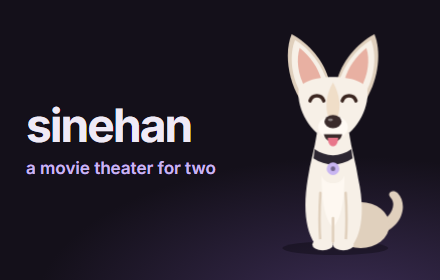
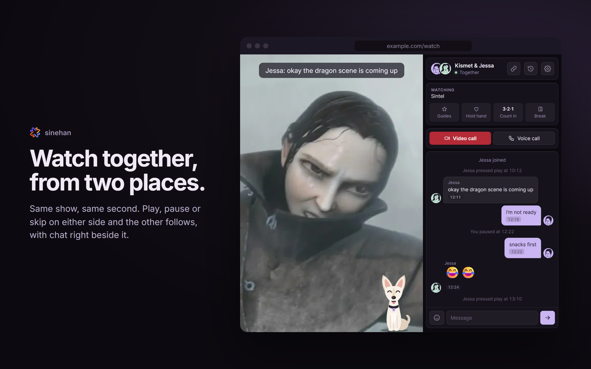
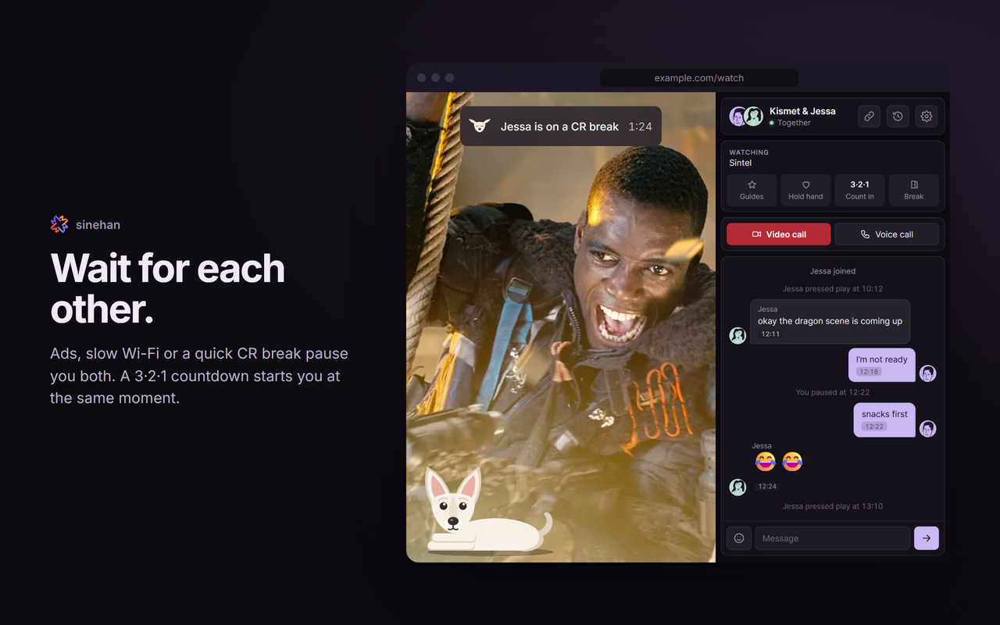
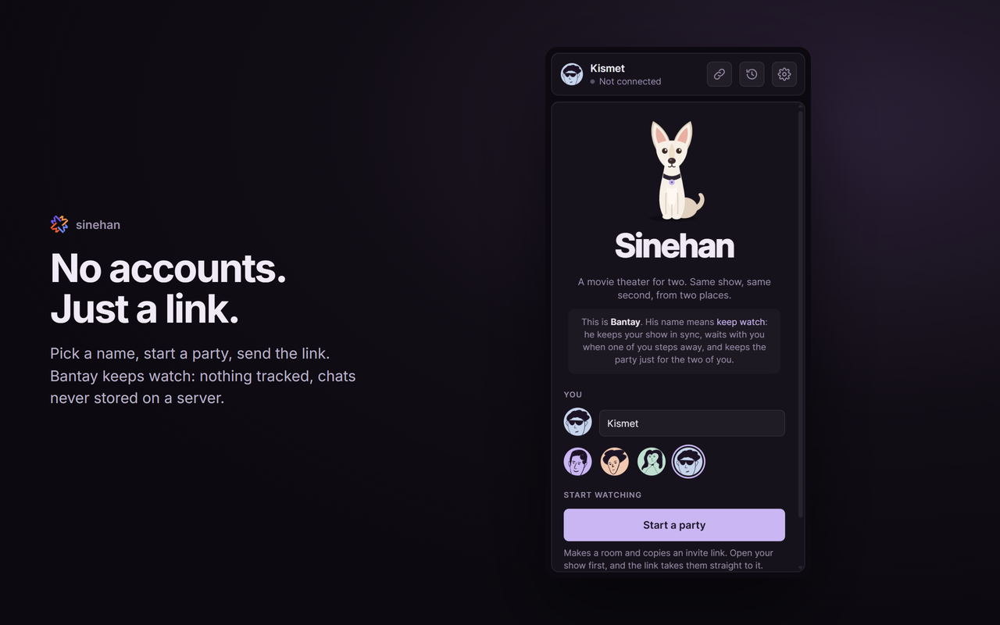

# Sinehan

<p align="center"></p>

A movie theater for two. Sinehan is a Chrome extension that keeps two people's video playback in sync on any site
(YouTube, Netflix, Prime Video, Crunchyroll, …), with chat, a video call and reactions in the sidebar. A small relay
server passes messages between them; there are no accounts.

## Features

- **Synced playback**: play, pause and seek mirror to the other person, but only from the tab picked as the show.
- **Ad and buffering holds**: if one of you hits an ad or a stall, the other waits, then both line back up.
- **Chat, video call and reactions** in the sidebar, plus a fullscreen chat/camera overlay on the video.
- **Invite links**: one click makes a private room and copies a link; the invite page opens the same show.
- **Breaks and countdowns**: pause for a break, come back with a 3-2-1 countdown; "stop for tonight" saves the spot.
- **Watch guides**: best episodes and watch orders pulled from Reddit, TVmaze and Wikipedia, shared and ticked off together.
- **Phone companion**: chat, reactions and a remote for the show playing on the laptop.
- **Past parties**: each party's chat is saved with what you watched.

## Screenshots







## Project layout

```
extension/          Chrome extension (Manifest V3)
  background.js     Service worker: relay connection, picks the watch tab, routes messages, keeps chat history
  content.js        Runs in pages: finds the player, syncs it, detects ads/buffering, in-video overlays
  netflix-main.js   Seeks through Netflix's own player API (setting currentTime crashes it)
  sidepanel.*       Sidebar UI: settings, invites, call (WebRTC), chat, guides
  reddit.js         Best episodes and watch guides from Reddit, TVmaze and Wikipedia
  bantay.js         Bantay, the mascot (also copied to server/public)
server/             Relay and website (Node + ws)
  server.js         WebSocket relay plus the web pages and GIF search proxy
  *.html            Landing, invite (/join), phone companion (/party), guide (/guide) and privacy pages
  public/           Static assets served under /static/
tests/              End-to-end and relay tests (Playwright)
store/              Chrome Web Store screenshots and promo art
build-zip.py        Packages the extension
```

## Running locally

### Relay server

Requires Node 18 or newer.

```sh
cd server
npm install
npm start          # listens on :8080
```

| Variable        | Purpose                                         |
| --------------- | ----------------------------------------------- |
| `PORT`          | Port to listen on (default `8080`)              |
| `KLIPY_API_KEY` | Key for GIF search; GIFs are off without it     |

Routes: `/` landing page, `/join` invite page, `/party` phone companion, `/guide` watch guide, `/privacy`,
`/download` the extension zip, `/gifs` GIF search, `/health` health check.

### Extension

1. Open `chrome://extensions` and turn on **Developer mode**.
2. Click **Load unpacked** and pick the `extension/` folder.
3. Open the sidebar from the toolbar icon. To use a local relay, set the server to `ws://localhost:8080` in Settings.

After changing extension code, click reload on `chrome://extensions` and refresh any open video tabs.

## Tests

```sh
cd tests
npm install
npx playwright install chromium
npm test           # end-to-end: two real Chromium browsers, the extension, a local relay and a test video
node relay.js      # relay limits: flood control, message size, room size, guide channels
```

## Building

```sh
python build-zip.py
```

This writes:

- `sinehan-extension.zip`, which is also copied to `server/public/` for the website's Download button
- `sinehan-store.zip`, with `manifest.json` at the top, for the Chrome Web Store
- `server/public/bantay.js`, a copy of the mascot for the website

Bump `version` in `extension/manifest.json` before building a release.

## Code style

JavaScript is formatted with [Prettier](https://prettier.io) (see `.prettierrc`):

```sh
npx prettier --write .
```

Comments explain *why*, not *what*; keep them short. Sections start with `// ---- Title ----`.

## Privacy

Chat history and guides stay in the browser's extension storage. The relay only passes messages along to the others
in your room; it doesn't store or log them. Calls are peer to peer, so audio and video never touch the server.
Reddit, TVmaze, Wikipedia/Wikidata and Fandom requests go straight from your browser. Full policy: `/privacy` on the
website (`server/privacy.html`).
